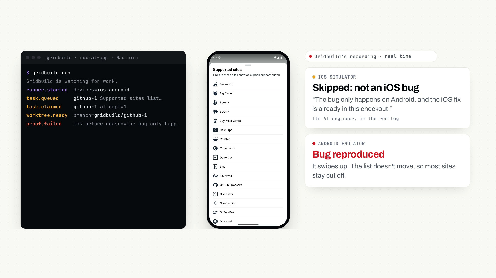
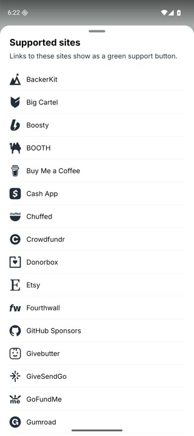
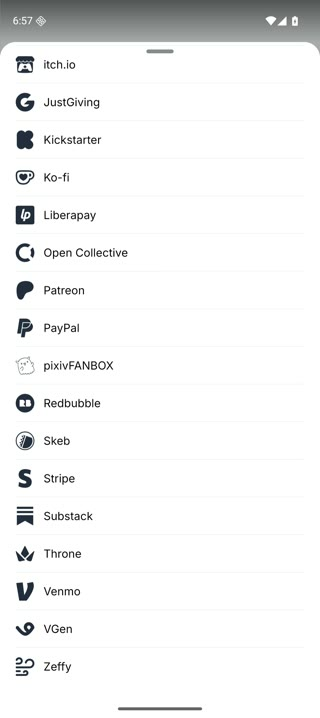

<p align="center"></p>

<h1 align="center">Gridbuild</h1>

<p align="center">An AI engineering team for your mobile app. It watches your tickets and crash reports, picks up the work, and opens tested pull requests from your own machines.</p>

<p align="center"><a href="https://gridbuild.iterelle.tech">Website</a> · <a href="https://gridbuild.iterelle.tech/demo/gridbuild-demo.mp4">Watch the demo</a> · <a href="https://github.com/YoruSamaOG/social-app/pull/2">See a real pull request</a></p>

<a href="https://gridbuild.iterelle.tech/demo/gridbuild-demo.mp4"></a>

<p align="center"><a href="https://gridbuild.iterelle.tech/demo/gridbuild-demo.mp4"><b>▶ Watch the 74-second demo</b></a> (no sound). A real run on October 31, 2026: an open Android bug in Bluesky's app, fixed on our fork for $7.05 of AI.</p>

| Before | After |
|---|---|
|  |  |
| The list won't scroll, so most sites stay cut off. | Fixed: the list scrolls to the end. Recorded by Gridbuild on the Android emulator. |

This repo is the first piece: the runner, the open-source program that runs an AI engineer on your Mac. Assign it a Jira ticket, label a GitHub issue `bot`, or let it pick up a new Crashlytics crash, and an AI engineer on your Mac fixes it and opens a pull request with before-and-after video from iOS and Android.

**Status:** pre-release. The whole loop is built and covered by tests that use stand-ins for GitHub, Jira, Firebase, Claude Code and the simulators. Its first real run, on a fork of Bluesky's app (above), fixed an Android bug on the emulator and opened a pull request with proof. Expect rough edges on your first run.

## How it works

1. Assign work: label a GitHub issue `bot` or assign a Jira ticket to Gridbuild. New Crashlytics crashes come in on their own.
2. Gridbuild picks it up on your Mac, makes a fresh git worktree on a `gridbuild/<task>` branch, and runs Claude Code there to fix it. Claude Code follows your repo's `CONTRIBUTING.md`, `CLAUDE.md` or `AGENTS.md`, and the lessons from past reviews.
3. It runs the app in the iOS Simulator and the Android Emulator and films the change, before and after. Your tests run too.
4. It opens a pull request with what was wrong, what changed, how it was tested, the videos and the test results, and what it couldn't check.
5. When you review, it answers your comments, re-tests, films the change again and pushes. Each correction becomes a lesson in `.gridbuild/lessons.md`, added as its own commit on the same pull request so you approve it like any other change.

Every step is written to an activity log, including how long each AI engineer run took and what it cost.

## Try it without any accounts

```sh
node test/dry-run.ts
```

This runs the whole loop on a small throwaway repo with a pretend AI engineer and pretend devices, and prints where to find the branch, the pull request text, the proof folder and the review reply. Nothing leaves your Mac.

## Quick start

You need Node 24 or newer. There is nothing to install: Gridbuild has no dependencies.

```sh
git clone https://github.com/Iterelle-tech/gridbuild.git
alias gridbuild="node $PWD/gridbuild/src/cli.ts"

cd ~/code/your-app
gridbuild init                  # writes gridbuild.json
gridbuild doctor                # checks git, gh, Claude Code, Xcode and Android tools
gridbuild once 42 --dry-run     # fixes issue #42 but writes the PR to a local folder
gridbuild once 42               # the same, and opens a real pull request
gridbuild run                   # keeps watching for work until you press Ctrl-C
gridbuild status                # the queue, pull requests, AI spend and recent activity
```

`once` also takes a Jira key (`APP-7`), a crash (`crashlytics:<issue id>`), or a Markdown file describing the task.

## Settings

`gridbuild.json` lives in your app's repo. Secrets never go in it; Gridbuild refuses to start if they do.

```json
{
  "baseBranch": "main",
  "test": "npm test",
  "watchers": {
    "github": { "label": "bot" },
    "jira": { "jql": "assignee = currentUser() AND statusCategory != Done" },
    "crashlytics": { "projectId": "your-gcp-project", "tables": ["com_example_app_IOS", "com_example_app_ANDROID"] }
  },
  "proof": {
    "deepLink": "yourapp://settings",
    "seconds": 90,
    "ios": { "run": "npx expo run:ios --configuration Release --no-bundler --device \"$GRIDBUILD_DEVICE_ID\"" },
    "android": { "run": "npx expo run:android --variant release --no-bundler" }
  }
}
```

- **GitHub:** issues with the label, read with `gh`. Pull requests go to the repo behind `origin`. If you set `watchers.github.repo`, it must be that same repo; Gridbuild refuses to start otherwise (forks are not supported yet).
- **Jira:** set `JIRA_BASE_URL`, `JIRA_EMAIL` and `JIRA_API_TOKEN` for the Jira account you assign tickets to. Gridbuild comments on the ticket when it starts, when the pull request is open, and if it gets stuck.
- **Crashlytics:** turn on [BigQuery export](https://firebase.google.com/docs/crashlytics/bigquery-export) in Firebase, then list the exported tables. Gridbuild reads them with your `gcloud` login (or `GOOGLE_OAUTH_ACCESS_TOKEN`) about once an hour. Each new fatal crash becomes one task with its stack trace, app versions and the number of users affected. The same crash never becomes two tasks.
- **Proof:** each `run` command builds the app, installs it on the device and opens it, then exits. While the device records, Claude Code moves through the app to show the problem and then the fix, within `seconds`. Set `deepLink` to start on the right screen. On iOS, Claude Code needs a way to tap, such as an MCP server, idb or Maestro. Leave a platform out to skip its video. The pull request says what was skipped.
- **Claude Code:** `agent.model`, `agent.minutes` (default 45), `agent.args` and `agent.env`. By default Claude Code runs with permission prompts off (`--permission-mode bypassPermissions`), because no one is there to answer them. See [Security](#security) for what it can see.
- **Review:** Gridbuild answers review comments from people with write access to the repo, and from anyone you list in `review.allowedUsers`.

Videos go on a separate `gridbuild-proof` branch and the pull request links to them, so they never show up in the fix itself. Gridbuild keeps its queue, activity log, worktrees and run folders in `~/.gridbuild/<repo name>-<id>/`, where the id comes from the repo's `origin` URL (change the folder with `stateDir`). Only one Gridbuild runs per repo at a time.

The queue survives restarts. Stop Gridbuild mid-task and the task carries on from the last finished step on the next start, without fixing or filming it again. If it was stopped in the middle of a fix, Gridbuild leaves the half-done changes as they are and marks the task as needing attention; `gridbuild status` says where they are.

## Security

- **Who can steer it.** Only people with write, maintain or admin access to the GitHub repo can give it work (by adding the `bot` label) or change its work (with review comments), plus anyone in `review.allowedUsers`. Labels and comments from anyone else are ignored. On Jira, anyone who can assign a ticket to the Gridbuild account can give it work.
- **What it reads as untrusted.** Issue, ticket, crash and comment text reaches Claude Code marked as untrusted data, with instructions to use it only to understand the problem.
- **What it can't see.** Claude Code, and the build and test commands it can change, get only `PATH`, `HOME`, `USER`, `LOGNAME`, `SHELL`, `LANG`, `LC_*`, `TMPDIR`, `TERM`, `DEVELOPER_DIR`, `ANDROID_HOME`, `ANDROID_SDK_ROOT` and `JAVA_HOME` from your environment, plus the names you list in `agent.env`. They never get `GH_TOKEN`, `GITHUB_TOKEN`, `JIRA_*`, `GOOGLE_*` or `AWS_*`, even if listed. If Claude Code signs in with `ANTHROPIC_API_KEY`, add that to `agent.env`. To send it through your company's AI gateway or OpenRouter, also add `ANTHROPIC_BASE_URL` and `ANTHROPIC_AUTH_TOKEN`.
- **What it publishes.** Pull requests, review replies, Jira notes and the activity log have secrets removed first: values of environment variables named like `TOKEN`, `SECRET`, `PASSWORD` or `KEY`, GitHub, Slack, AWS and Google tokens, bearer tokens, private keys and passwords in URLs. Full build and test logs stay on your Mac, readable only by you.
- **What it can still reach.** With permission prompts off, Claude Code can do anything your macOS user can, including using tools that are already signed in, such as `gh`. Run Gridbuild under its own macOS user, signed in to a GitHub account that can only reach this repo.

## Runs on your Macs

Gridbuild runs on the Macs your team already keeps for builds, with your Xcode, simulators and emulators. Your code stays there. It only goes to the AI provider you already use, on your own account.

## Requirements

- Node 24 or newer
- A Mac with Xcode and the iOS Simulator
- Android Studio with an emulator, for Android apps (set `ANDROID_HOME`)
- [Claude Code](https://code.claude.com/docs), signed in with your own subscription or API key. Codex support is coming next.
- [GitHub CLI](https://cli.github.com) (`gh`), signed in
- For Crashlytics: the BigQuery export turned on, and the [gcloud CLI](https://cloud.google.com/sdk/docs/install) signed in

Run `gridbuild doctor` to check them all. It tells you what to fix, including a stuck iOS Simulator service.

## Not yet

- More than one machine, and a dispatcher that hands work out across them
- Finding work from Sentry errors and App Store reviews
- Hosted Macs and real phones, for teams without their own Macs

## Development

```sh
node --test
```

The tests use stand-ins for every outside tool, so they never call GitHub, Jira, Firebase, Claude or a simulator.

## License

[MIT](LICENSE)
